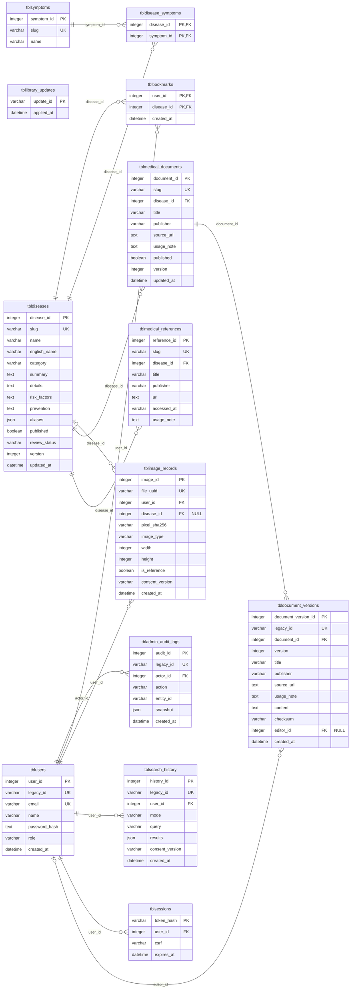

# ERD tổng thể website Derma

Một sơ đồ duy nhất gồm toàn bộ 13 bảng, gộp phần tài khoản, ảnh và nội dung thư viện. Mỗi bảng chỉ xuất hiện một lần.

Đối chiếu với `backend/app/database/models.py` ngày 23/10/2026. Chưa đối chiếu schema trực tiếp trên SQL Server. Kiểu dữ liệu trong hình là kiểu model SQLAlchemy; SQL Server có thể dùng kiểu tương ứng như NVARCHAR và BIT.

## Sơ đồ

## Chú thích

- PK: khóa chính; FK: khóa ngoại; UK: giá trị duy nhất.
- Hai cột PK trong `tblbookmarks` và `tbldisease_symptoms` tạo khóa chính ghép.
- `||`: đúng một; `o|` hoặc `|o`: không hoặc một; `o{`: không hoặc nhiều.
- `tblimage_records.disease_id` và `tbldocument_versions.editor_id` được phép NULL.
- Nhãn trên đường nối là cột khóa ngoại ở bảng con.
- `tbllibrary_updates` đứng độc lập vì model không khai báo khóa ngoại.
- `tbladmin_audit_logs.entity_id` là mã đối tượng được ghi nhật ký, không phải khóa ngoại cố định.
- `tblsearch_history.results` lưu JSON; không vẽ thêm quan hệ khóa ngoại từ các mã trong JSON.

Các ràng buộc xóa, index và giá trị mặc định xem trong model; sơ đồ không thay thế migration hoặc bản thiết kế vật lý SQL Server.
